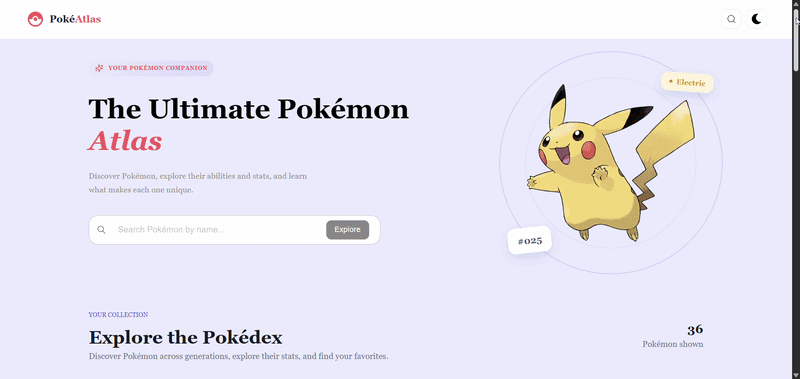

# PokeAtlas

A modern, interactive Pokémon explorer built with **React, TypeScript, and Redux Toolkit**.

PokeAtlas allows users to explore Pokémon, search by name, filter Pokémon by their types, and view detailed Pokémon information through an interactive card interface. The application integrates the **PokéAPI** to retrieve Pokémon data dynamically and provides a dark mode for a more customizable browsing experience.

The project is deployed using **Firebase Hosting**.

---

## 🎥 Preview



---

## 🌐 Live Demo

**PokeAtlas:**  
https://pokeatlass.web.app/

---

## 🛠️ Technologies

- React
- TypeScript
- Redux Toolkit
- React Redux
- `createAsyncThunk`
- PokéAPI
- Material UI (MUI)
- React Icons
- CSS
- Firebase Hosting

---

## ✨ Features

### 🧩 Single-Page Component Architecture

PokeAtlas is built as a single-page React application with independently developed components.

The main application integrates the following components:

- **Header** — Provides the top-level navigation and interface controls.
- **Hero** — Introduces the application.
- **Loading** — Handles loading feedback during data retrieval.
- **PokeList** — Displays the Pokémon collection.
- **Footer** — Provides the footer section.

Each component is maintained separately to improve code organization, reusability, and maintainability.

---

### 🔗 PokéAPI Integration

The application retrieves Pokémon data from the PokéAPI, providing access to Pokémon information without requiring the entire dataset to be hardcoded locally.

The API integration uses Redux Toolkit's `createAsyncThunk` to manage asynchronous requests.

The general data flow is:

1. An asynchronous request is dispatched.
2. Pokémon data is retrieved from the API.
3. Redux processes the request result.
4. The application state is updated.
5. React components render the available data.

This approach separates data retrieval and state management from the presentation layer.

---

### 🔍 Pokémon Search

PokeAtlas includes a search feature that allows users to find Pokémon by name.

When a Pokémon's full name is entered, the application can display a detailed Pokémon card with additional information.

The search functionality makes it easier to navigate the Pokémon collection and access information about a specific Pokémon.

---

### 🔥 Pokémon Type Filtering

Users can filter Pokémon according to their types, such as:

- Fire
- Water
- Grass
- Electric
- Psychic
- Ground
- Flying
- Dragon

This functionality helps users explore Pokémon based on their type rather than browsing the entire collection.

---

### 📋 Detailed Pokémon Cards

PokeAtlas provides an interactive card interface for displaying Pokémon information.

Searching for a Pokémon by its full name opens its detailed card view, making it easier to focus on a specific Pokémon and explore its available information.

The card interface works together with the search and filtering features to provide a more interactive browsing experience.

---

### 🌙 Dark Mode

The application includes a dark mode that allows users to switch to a darker interface.

This feature provides an alternative visual experience and makes the application more customizable according to user preference.

---

### 🔄 Redux Toolkit State Management

**Redux Toolkit** is used to manage application state centrally.

The Pokémon state includes the following properties:

```ts
const initialState: StateType = {
  pokemons: [],
  filteredPokemons: [],
  selectedPokemon: null,
  loading: false,
  error: null
};
```

The state is designed to manage:

- `pokemons` — The Pokémon collection.
- `filteredPokemons` — The Pokémon list used for filtered results.
- `selectedPokemon` — The currently selected Pokémon.
- `loading` — The loading status of asynchronous operations.
- `error` — Error information associated with requests.

Using a centralized state helps keep Pokémon data and UI-related state organized across the application.

---

### ⚡ Asynchronous Data Handling

API requests are implemented using `createAsyncThunk` within the Redux slice structure.

This allows asynchronous operations to be integrated with Redux state management and supports handling request lifecycle states, including loading, success, and failure.

The loading and error state properties help the application respond to API request outcomes.

---

### 🛡️ TypeScript

TypeScript is used throughout the application to provide type safety and improve maintainability.

The project uses typed state definitions to make the structure of Pokémon data and application state more predictable.

For example:

```ts
interface StateType {
  pokemons: Pokemon[];
  filteredPokemons: Pokemon[];
  selectedPokemon: Pokemon | null;
  loading: boolean;
  error: string | null;
}
```

*Note: The interface above illustrates the state structure; the actual project types may differ.*

---

## 📂 Project Structure

A simplified representation of the application's architecture:

```text
src/
├── components/
│   ├── Header/
│   ├── Hero/
│   ├── Loading/
│   ├── PokeList/
│   └── Footer/
│
├── redux/
│   ├── slices/
│   └── ...
│
├── App.tsx
└── ...
```

The application separates UI components and Redux logic into dedicated areas, making the codebase easier to navigate and maintain.

*The structure above is illustrative and may not include every file in the actual project.*

---

## 🔄 Data Flow

The application's data flow can be summarized as follows:

```text
PokéAPI
   ↓
createAsyncThunk
   ↓
Redux Slice
   ↓
Redux Store
   ↓
Pokémon Data and Filtering
   ↓
React Components
   ↓
Pokémon Cards
```

The API layer handles data retrieval, Redux manages application state, and React components present the information to users.

---

## 🚀 Deployment

PokeAtlas is deployed using **Firebase Hosting**.

**Production URL:**  
https://pokeatlass.web.app/

---

## 💻 Installation

Clone the repository:

```bash
git clone <repository-url>
```

Navigate to the project directory:

```bash
cd <project-directory>
```

Install the dependencies:

```bash
npm install
```

Start the development server:

```bash
npm run dev
```

The application will be available at the local development URL provided by the development server.

---

## 📌 Project Goals

PokeAtlas was developed as a practical project to explore modern frontend development concepts.

The main focus areas include:

- React component architecture
- TypeScript and type safety
- Redux Toolkit state management
- Asynchronous API requests with `createAsyncThunk`
- REST API integration with PokéAPI
- Pokémon search and type-based filtering
- Dynamic data rendering
- Loading and error state management
- Interactive UI components
- Dark mode
- Firebase deployment

---

## 👨‍💻 Developer

**Berat Karabulut**

**Live Demo:**  
https://pokeatlass.web.app/

**GitHub:**  
<repository-url>
